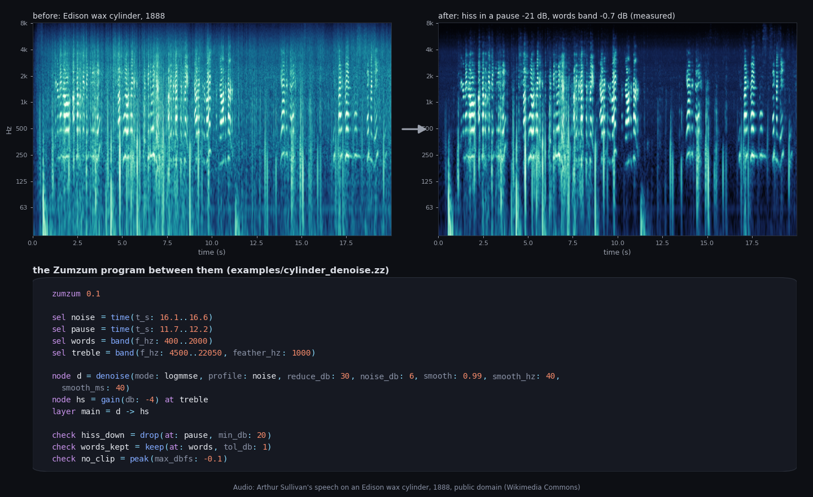
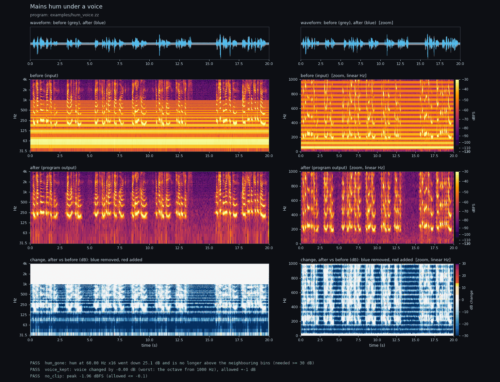
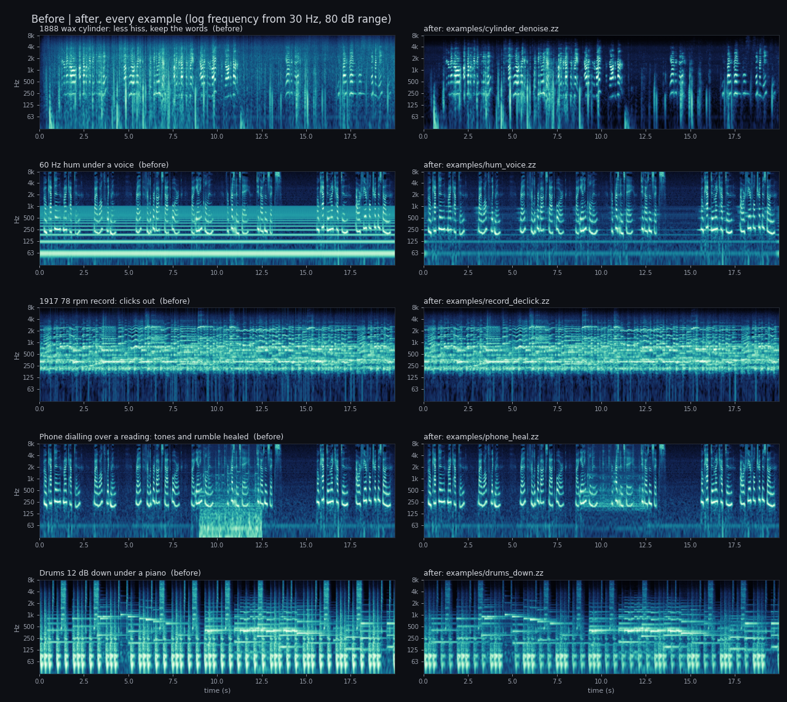

# Zumzum

Zumzum is a small language for audio repair. A program says which part of the sound to work on, what to do to it,
and what has to be true afterwards, for example that the hum dropped by 30 dB and the voice stayed within 1 dB.
Zumzum checks the program before running it, renders it with a NumPy reference engine, then measures each of those
conditions on the result.

This started with old recordings, like the 1888 wax cylinder below. I wanted each cleanup written down as a program
I could read again later, with the result measured instead of judged by ear alone. Programs can also be written by
simple keyword rules or by a local AI model; they go through the same checker as a hand-written one. So far it
handles hum, hiss, clicks, short tones such as phone dialling, and turning drums down under other music.



The program on the left is [examples/cylinder_denoise.zz](examples/cylinder_denoise.zz). It learns the noise from
one pause, and the hiss in another pause goes down about 23 dB while the band with the words changes by 0.4 dB.

**Contents:** [A program](#a-program) · [Quick start](#quick-start) · [Your own file](#your-own-file) ·
[The examples](#the-examples) · [Asking in words](#asking-in-words) · [Limits](#limits)

## A program

```
zumzum 0.1
name "Mains hum under a voice"

sel hum_lines = harmonics(f0_hz: 60, count: 16, width_hz: 50)
sel voice = band(f_hz: 200..4000) and not hum_lines

node h = dehum(f0_hz: 60, harmonics: 16, depth_db: 50)
layer main = h

check hum_gone = hum_drop(f0_hz: 60, harmonics: 16, min_db: 30)
check voice_kept = keep(at: voice, tol_db: 1)
check no_clip = peak(max_dbfs: -0.1)
```

Here `voice` is the 200 to 4000 Hz band minus the hum lines. `h` is the only node, and since `main` is the only
layer, it's also the output. With several layers, an `output` line picks one or mixes them with gains in dB. A node
can be limited to a region with `at`, applied partly with `mix`, or switched off with `off`. Besides the three
checks, Zumzum measures each node's own effect inside and outside its region, so you can see which node did what.

Regions are built from `time`, `band`, `box`, `harmonics` and `all`, combined with `and`, `or` and `not`. Units are
part of every parameter name (`_s`, `_ms`, `_hz`, `_db`, `_dbfs`). It's deliberately not a general programming
language: a program can't open files, loop, calculate or use randomness, and its size and cost are limited. The
checker validates every name, unit and range and reports each problem with its line number.

The operations are `gain`, `dehum`, `denoise` (from a noise profile you point at with `profile_t_s`, or from the
quietest frames), `declick` (its region can only be a time span), `heal` (fills a region from the sound around it)
and `split_hp` (keeps the harmonic or the percussive part). The checks are `drop`, `change`, `keep`, `untouched`,
`hum_drop`, `clicks`, `peak`, and `musical_noise`, which is experimental, not validated and not used by any
example. A damage gate always runs as well: an output with non-finite samples, a peak above 0 dBFS, more than 6 dB
louder than the input or more than 40 dB quieter never counts as done.

The full language is in [docs/spec.md](docs/spec.md), and [zumzum/ops.py](zumzum/ops.py) has every parameter with
its range and default.

## Quick start

You need Python 3.12 or later. Clone this repository and run these from its folder (on Windows, activate with
`venv\Scripts\activate`):

```
python -m venv venv && . venv/bin/activate
pip install -r requirements.txt
python -m pytest -q                       # no network, GPU or model needed
python tools/fetch_audio.py               # seven recordings into cache/audio/, checked by SHA-256
python tools/make_examples.py             # renders five examples into out/examples/ (a few minutes)
```

The tests should all pass in under a minute. `fetch_audio.py` needs a network connection the first time.
`make_examples.py` prints each check as PASS or FAIL, and the first line of each example says `ALL PASS` when every
check passed and the damage gate is clear. `python tools/make_examples.py hum_voice` renders just one. Each example
folder gets `before.wav`, `after.wav`, `removed.wav` (what the edit took out), `results.json` with every check, and
`sheet.png` with the waveform, spectrograms before and after, and a map of what changed.



This is the sheet for `hum_voice`. The bright horizontal lines in the top spectrogram are the hum; they are gone in
the second one. The bottom map shows in blue what was removed, and the three lines under it are the checks.

## Your own file

This needs [ffmpeg](https://ffmpeg.org/) on your PATH (not included; it has its own licence).

```
python tools/convert.py examples/mp3_record.zz input.mp3 output.mp3 --sheet sheet.png
```

The input can be any common audio or video file. The output type follows its extension (`.mp3`, `.m4a`, `.flac`,
`.wav`); for `.mp4`, `.mov` or `.mkv` the picture is copied and only the sound is replaced. The checks are printed
and saved to `output.json`. The exit code is 0 only when every check passes and the damage gate is clear, so it
works in scripts. An existing output, its `.json` or the sheet isn't replaced unless you add `--overwrite`, and the
input is never written over.

To try it on the 1920 record that `fetch_audio.py` downloads:

```
ffmpeg -t 60 -i cache/audio/mp3_sandman_1920.mp3 -c copy sandman_60s.mp3
python tools/convert.py examples/mp3_record.zz sandman_60s.mp3 sandman_clean.mp3 --sheet sandman_sheet.png
```

Each example is tuned to its own recording. Before using one on another file, change its `time(...)`,
`profile_t_s` and band values.

## The examples



| example | asked for | measured in 0.1 |
|---|---|---|
| [hum_voice.zz](examples/hum_voice.zz) | remove 60 Hz hum, keep the voice | hum no longer above the spectrum around it; voice band within 0.01 dB |
| [cylinder_denoise.zz](examples/cylinder_denoise.zz) | less hiss on the 1888 cylinder, keep the words | hiss in a pause down 23 dB; words within 0.4 dB |
| [record_declick.zz](examples/record_declick.zz) | clicks out of a 1917 78 rpm record | 451 clicks before, 70 after (100 allowed); music within 0.01 dB |
| [phone_heal.zz](examples/phone_heal.zz) | dial tones and rumble out of a reading | tones down 11.5 dB, rumble down 29 dB; the change elsewhere 66 dB below the sound there (30 dB required) |
| [drums_down.zz](examples/drums_down.zz) | drums down about 12 dB under a piano | cymbal band down 11.9 dB; piano within 1.5 dB (3 allowed) |
| [mp3_record.zz](examples/mp3_record.zz) | clicks and hiss out of a 1920 record, mp3 in and out | 200 clicks before, 26 after (60 allowed); hiss in the lead-in down 15.6 dB; band within 1.2 dB |

The first five come from `tools/make_examples.py`, the mp3 one from `convert.py` as shown above. There's also
[video_denoise.zz](examples/video_denoise.zz), written for a 1920s newsreel clip that `fetch_audio.py` doesn't
download, so it has no result here; use it as a starting point for your own video.

These numbers tell you whether the requested change happened. They don't tell you whether it sounds right, so
listen to the result too.

The recordings are public domain or CC0 files from Wikimedia Commons, listed with their licences and SHA-256 in
[examples/sources.json](examples/sources.json). Where a recording had no fault of its own, the example adds one
(hum, clicks, dialling) with a fixed seed, or mixes two recordings.

## Asking in words

`tools/live_run.py` runs the five example inputs with a plain note each, such as "There is a mains hum under the
voice. Remove it, keep the voice as it is." Fixed word rules in [zumzum/notes.py](zumzum/notes.py) turn the note
into checks, so the goal is measured the same way whoever writes the program. Hum has to drop at least 20 dB, hiss
at least 6 dB, and a kept voice or piano band has to stay within 3 dB. For hum, hiss and drums, a dB amount in the
note replaces the default. `notes.py` has every trigger word and band.

```
ZUMZUM_DRIVER=rules python tools/live_run.py hum_voice
ZUMZUM_DRIVER=openweight ZUMZUM_LLM_URL=http://127.0.0.1:8091/v1 python tools/live_run.py
```

Without names it runs all five (in PowerShell, set the variable first: `$env:ZUMZUM_DRIVER = "rules"`). `rules`
needs no model; `openweight` talks to any OpenAI-compatible chat server running a local model, such as llama.cpp's
`llama-server`. The model never hears the sound. It gets the note and some measurements (levels, noise floor, quiet
spans, hum, click count, steady tones) and answers with a Zumzum program, which is checked like any other. After
each try it gets the failed checks and checker errors back as text, for up to three versions.

Each version ends as `done`, `not_done`, `damaged`, `unmeasurable` (nothing to measure the goal against) or
`unsupported` (no rule understood the note). Results go to `out/llm/<driver>/`.

## Limits

Zumzum 0.1 is a prototype and the language may change. The checks are objective measurements; there are no
perceptual checks yet. Regions are simple shapes in seconds and hertz.

Channels are processed independently, and there are no stereo-aware operations. `split_hp` is signal processing,
not a trained separation model, so "drums down" is approximate.

There's one engine, NumPy on the CPU. Audio can be 8 to 192 kHz, up to 8 channels and up to an hour, and rendering
holds several copies of it in memory.

Planned: time stretch and pitch shift of a region, de-reverb, separation into layers with trained models (with a
residual layer so nothing is lost), perceptual checks calibrated by listening, and faster engines tested against
the reference.

## Contributing

Issues and pull requests are welcome. Please run `python -m pytest -q` before sending a change; the tests also run on
GitHub Actions with Python 3.12 and 3.13. A change to the language goes into [docs/spec.md](docs/spec.md) and
[zumzum/ops.py](zumzum/ops.py) together. Contributions are accepted under the Apache License 2.0.

## Licence

Apache-2.0. See [LICENSE](LICENSE) and [NOTICE](NOTICE). The example recordings are not part of this repository;
their own licences are listed in [examples/sources.json](examples/sources.json).

## Name

"Zumzum" is the name of this project. The Apache License 2.0 does not give permission to use this name (see section
6 of the license), except to say truthfully where the software comes from. If you publish a changed version, please
give it a different name, so that people can tell it apart from this one.
