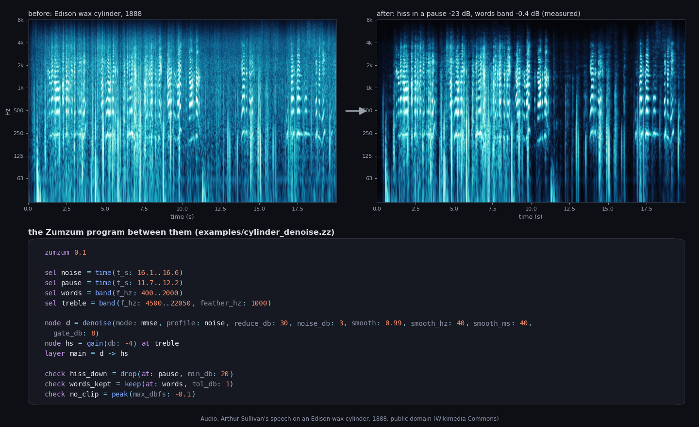
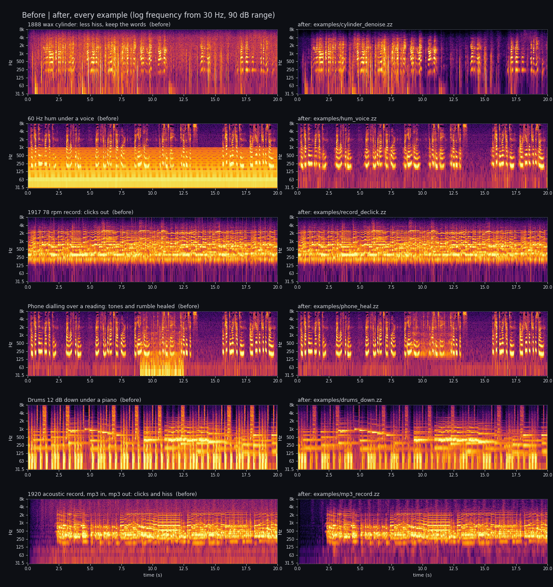

# Zumzum

**Spectral audio editing as a small language that people and AI models can write.** A repair or an edit, such as
removing hum, lowering hiss, taking out clicks, healing a cough or a phone tone, or turning the drums down under a
piano, is a short, readable program over time and frequency. Zumzum checks the program, renders it with one NumPy
reference engine, and measures whether each request was met.



The program on the left is [examples/cylinder_denoise.zz](examples/cylinder_denoise.zz): a noise-reduction node, a
treble cut and three checks. It learns the noise from one pause, takes the hiss in another pause down about 23 dB,
and changes the words band by only 0.4 dB.



```
zumzum 0.1
name "Mains hum under a voice"

sel hum_lines = harmonics(f0_hz: 60, count: 16, width_hz: 50)
sel voice = band(f_hz: 200..4000) and not hum_lines

node h = dehum(f0_hz: 60, harmonics: 16, depth_db: 50)
layer main = h

check hum_gone = hum_drop(f0_hz: 60, harmonics: 16, min_db: 30)
check voice_kept = keep(at: voice, tol_db: 1)
```

## What it does

- **An edit you can read.** Regions are boxes, bands and harmonic series written in seconds and hertz. Nodes apply
  one operation each inside a region. Layers are chains of nodes, and the output is one layer or a mix of them.
  Every change is a diff of a few lines of text.
- **Checked before it runs.** Every name, type, unit, range and size limit is checked, and every problem comes back
  with its line number. A program that passes is safe to render, whoever wrote it: it has no I/O, no loops and no
  arithmetic, and its cost is bounded.
- **Requests become measurements.** "Hum down 30 dB", "voice band kept within 1 dB", "no more than 100 clicks left"
  and "nothing outside the region changed" are checks on the before / after pair. Each node's own effect is measured
  too, so a revision knows which node to change. A damage gate (clipping, near silence, a much louder output) keeps a
  broken version from counting as done.
- **Made for AI models.** A model gets the request and numbers measured on the sound (levels, noise floor, quiet
  spans, hum, clicks, steady tones), and answers with a Zumzum program. The checker treats that program like any
  other input. A local open-weight model can run the loop (request, program, render, checks, revision). A rules
  driver works with no model at all.
- **One reference engine.** NumPy STFT / ISTFT with perfect reconstruction (tested to 1e-12), and the ops `gain`,
  `dehum`, `denoise` (MMSE, Wiener or spectral subtraction), `declick` (autoregressive interpolation), `heal` (fill a
  region from its surroundings) and `split_hp` (harmonic / percussive split, no trained model).

The language is defined in [docs/spec.md](docs/spec.md).

## Quick start

You need Python 3.12 or later.

```
python -m venv venv && . venv/bin/activate
pip install -r requirements.txt
python -m pytest                          # the test suite; no network, GPU or model needed
python tools/fetch_audio.py               # the example recordings (public domain / CC0), checked by SHA-256
python tools/make_examples.py             # render the five examples: clips, sheets and results in out/examples/
python tools/make_readme_figures.py       # the two figures above
```

## Your own files: mp3 in, mp3 out

```
python tools/convert.py examples/mp3_record.zz input.mp3 output.mp3 --sheet sheet.png
```

ffmpeg is not included; install it yourself under its own licence. `tools/convert.py` uses it to decode any file it reads and encode by the output's
extension: .mp3, .m4a, .flac or .wav. For a video (.mp4, .mov, .mkv) the picture is copied untouched and only the
sound is replaced. The checks are printed and saved next to the output. For the mp3 example, take the first 60 s of
the record that `tools/fetch_audio.py` downloads (`cache/audio/mp3_sandman_1920.mp3`).

## The examples

Each example writes `before.wav`, `after.wav`, `removed.wav`, a sheet (`sheet.png`: waveform, spectrogram before
and after, and a map of what changed) and `results.json` with every check.

| example | request | program |
|---|---|---|
| hum under a voice | remove the 60 Hz hum, keep the voice | [examples/hum_voice.zz](examples/hum_voice.zz) |
| 1888 wax cylinder | less hiss, keep the words clear | [examples/cylinder_denoise.zz](examples/cylinder_denoise.zz) |
| 1917 78 rpm record | take out the clicks, change nothing else | [examples/record_declick.zz](examples/record_declick.zz) |
| phone dialling over a reading | remove the dial tones and the rumble, keep the voice | [examples/phone_heal.zz](examples/phone_heal.zz) |
| drums over a piano | drums down about 12 dB, leave the piano | [examples/drums_down.zz](examples/drums_down.zz) |
| 1920 acoustic record, **mp3 in, mp3 out** | take out the clicks and the hiss, keep the band | [examples/mp3_record.zz](examples/mp3_record.zz) |

Audio sources and licences are in [examples/sources.json](examples/sources.json): public domain and CC0 recordings
from Wikimedia Commons. The audio itself is never stored in this repository. Where a recording has no fault of its
own, the example adds one (hum, clicks, a phone recording) with a fixed seed, as `tools/make_examples.py` describes.

## The editing loop

```
ZUMZUM_DRIVER=rules python tools/live_run.py
ZUMZUM_DRIVER=openweight ZUMZUM_LLM_URL=http://127.0.0.1:8091/v1 python tools/live_run.py
```

`openweight` talks to any OpenAI-compatible chat server (for example llama.cpp's `llama-server`) with a local model.
Each request gets up to three versions. Checker problems and failed checks go back to the model as text.

## Status

Zumzum 0.1 is a prototype. Still to come: time stretch and pitch shift of a region, de-reverb, separation into
layers with trained models (with a residual layer so nothing is lost), perceptual quality checks calibrated by
listening, views of the sound for models, and faster engines tested against the reference.

## Licence

Apache-2.0. See [LICENSE](LICENSE) and [NOTICE](NOTICE).
